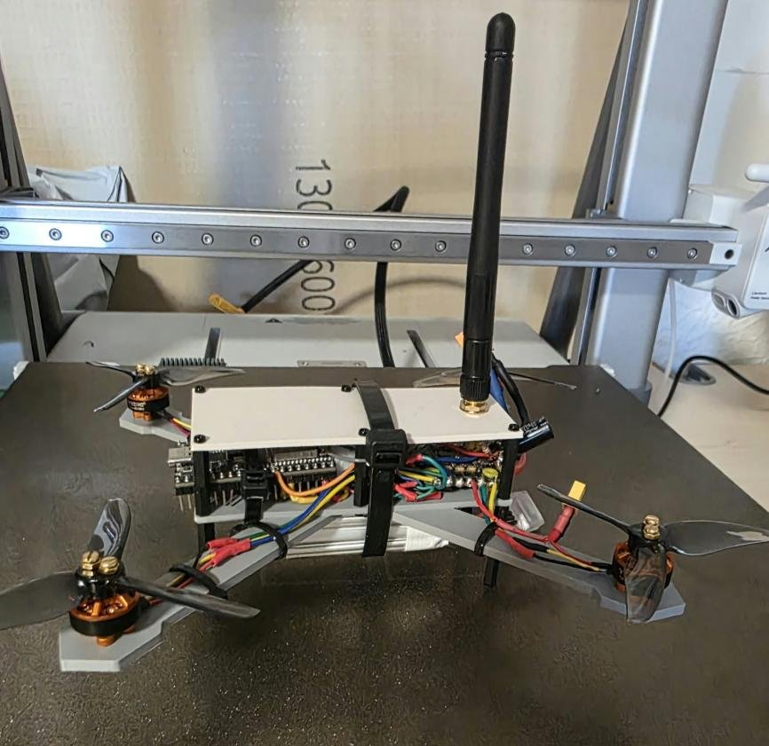
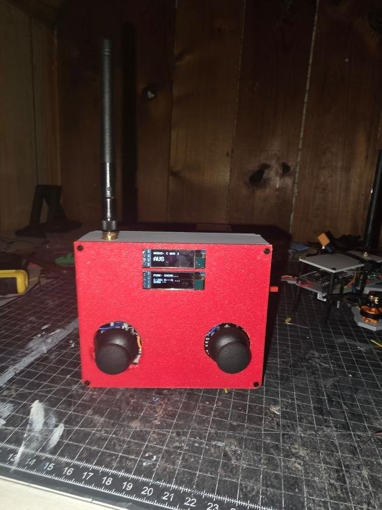
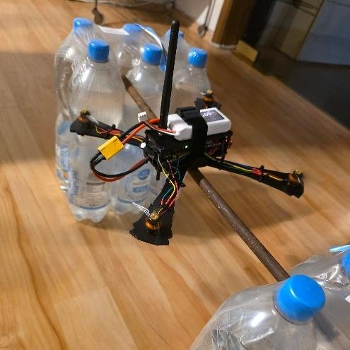
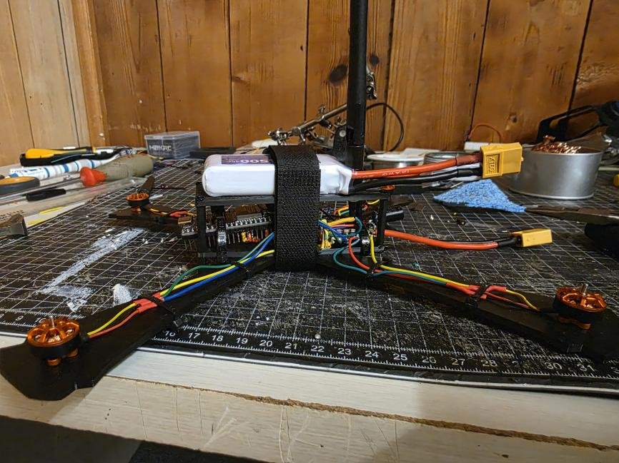

# ESP32 Quadcopter

A small quadcopter with a flight controller I wrote myself on an ESP32, plus a custom remote control built on a second ESP32. The two talk over ESP-NOW. The frame and the remote housing are my own designs, 3D printed in PLA.

This was my project for the course *Projektseminar 1* (EIT-F-500) at Technische Hochschule Mittelhessen, summer semester 2026. The task was to program the flight control yourself instead of using Betaflight, ArduPilot or PX4. Betaflight was the main reference for ideas such as airmode.

<p>
  
  
</p>

## Status

The drone flies and holds its attitude, and it can be flown with the remote. It does **not** hold its position or altitude yet. With only an IMU there is no reference to the ground, so it drifts slowly and needs a large open space outside. See [Next steps](#next-steps).

## Hardware

| | Drone | Remote |
|---|---|---|
| MCU | ESP32 DevKitC (WROOM-32U, external antenna) | same |
| Sensors | MPU6050 (gyro + accelerometer, I2C) | 2x KY-023 joystick |
| Output | 4-in-1 ESC HAKRC BLHeli_S 15 A, 400 Hz PWM | 2x 0.91" OLED (SSD1306) |
| Motors | 4x YSIDO 1204 6000 KV, Gemfan 3020 props | |
| Power | Tattu 3S 650 mAh, micro BEC to 5 V | 18650 cell from an old power bank, USB-C charger, 5 V boost |
| Weight | 167.5 g with battery | |

Total cost was about 132 EUR including spare parts.

Wiring diagrams: [drone](docs/images/schematic_drone.png), [remote](docs/images/schematic_remote.png). Labels are in German.

**Drone pins:** motors FL / FR / BL / BR on GPIO 32 / 25 / 27 / 26, MPU6050 SDA 21 / SCL 23, battery voltage divider (31.6k / 9.86k) on GPIO 34.

## How the flight controller works

```
remote ──ESP-NOW──> RX callback ──(critical section)──> flightControlTask, core 1, 1 kHz
                                                        │
  MPU6050 ─> complementary filter ─> angle loop (P) ─> rate loop (PID) ─> airmode mixer ─> ESC
                                                        │
  batteryMonitorTask, telemetryTask  (core 0) <─────────┘   telemetry back to the remote
```

* **Tasks.** The control loop runs in a FreeRTOS task on core 1, triggered by a hardware timer at 1 kHz. Battery measurement and telemetry run on core 0 at lower priority. An early version had everything in one loop and the timing between control cycles was uneven because serial output blocked it.
* **Attitude estimate.** Complementary filter with a time constant of 1 s. My first version used alpha = 0.98 at 1 kHz, which is only 49 ms. That let vibration through as fake tilt and the I-term integrated it.
* **Cascaded control.** Per axis an outer P loop turns the angle error into a rate setpoint (KP_ANGLE = 4, limited to ±250 °/s). An inner PID loop (QuickPID) controls the rate measured by the gyro, filtered with a PT1 low pass so the D-term does not amplify noise.

  | Axis | Kp | Ki | Kd |
  |---|---|---|---|
  | Roll | 0.35 | 0.3 | 0.0007 |
  | Pitch | 0.4 | 0.3 | 0.0007 |
  | Yaw | 0.6 | 0.3 | 0 |

* **Yaw heading hold.** When the yaw stick is released, the drone holds the heading it had instead of only holding zero rate.
* **Airmode mixer.** If the motor spread asked for by the PID does not fit, all four values are scaled down evenly, then the base throttle is shifted so no motor hits idle or full. Without this the drone lost control right at take-off.
* **Battery compensation.** The PID output is scaled with 12.6 V / battery voltage so the tuning stays similar while the battery drains.

### Safety

* Arming only with all sticks centred (checked on the remote) and throttle below 1220 (checked again on the drone).
* No arming at all if the MPU6050 does not answer or ESP-NOW fails to start. Motors stay at 1000 µs.
* Failsafe after 500 ms without a packet: disarm and centre the sticks.
* After disarm the throttle ramps down over about 2.5 s. I added this after a panic disarm in a test flight dropped the drone straight to the ground.
* Runaway stop: if the PID output stays above 350 for too long (I-term windup, e.g. the drone is stuck in grass or on the test rig), the motors are cut.
* The RX callback drops packets with the wrong length and copies valid ones inside a critical section, so the control loop never reads a half written packet.

### Remote control

The throttle stick springs back to centre, so it works as a "virtual" throttle: up raises the value at 200 µs/s, down lowers it, centre keeps it. Stick centres are measured at power on. If an axis is far outside the expected range, arming is blocked and the display shows which axis is faulty. The displays show link state, both battery levels, calibration state, gyro drift and IMU temperature.

## Debugging stories

Most of the time went into finding problems, not writing code. Some that taught me the most:

* **Drone kept rolling left.** The serial log showed `STICK r:1004` no matter how I moved the stick. A wire to the roll potentiometer was broken. Since then the remote checks every axis at startup.
* **Motors went to full throttle at about 2 % throttle.** I retuned the PID several times before logging the raw stick values. The remote was sending raw ADC values (1900 to 2250 at rest) instead of 1000 to 2000, so the drone saw a large constant stick command and the I-term ran away. The controller was fine, its input was wrong.
* **One motor stopped working.** Resoldering did nothing, a motor screw that was too long was not the cause either, and the signal from the ESP32 was there. A continuity check with a multimeter finally showed a break inside one of the motor phase wires.
* **Gyro drift of −17.3 °/s right after power on.** The sensor was still cold. Calibrating after a short warm-up fixed it, and the remote now shows drift and temperature so you know when to calibrate.
* **Could not take off although the battery was not empty.** The 2S pack sagged below 7 V under load. Switching to 3S and building a lighter frame with 94 mm instead of 134 mm arms (230 g down to 167.5 g) brought take-off throttle from 60–70 % down to 30–40 %.

<p>
  
  
</p>

*Left: test rig made of two water crates and a metal rod, used to tune one axis at a time. Right: the first frame with 134 mm arms and the battery on top, which was too heavy to correct tilt.*

## Repository layout

```
firmware/flight_controller/   flight controller (drone)
firmware/remote_control/      remote control
hardware/cad/                 3D models of the frame and remote housing (3MF)
docs/                         project report (German, PDF) and images
```

## Build and flash

Arduino IDE with the ESP32 board package (3.x). Libraries:

* Flight controller: `MPU6050`, `QuickPID` (both from the Library Manager)
* Remote: `Adafruit GFX`, `Adafruit SSD1306`

Before flashing the remote, put the MAC address of your drone's ESP32 into `droneAddress` in `remote_control.ino`. The drone learns the address of the remote from the first packet it receives.

Test without propellers first.

## Next steps

I already have the sensors for position and altitude hold:

1. **VL53L1X** (time of flight) and **BMP580** (barometer) on the existing I2C bus for altitude hold.
2. **PMW3901** optical flow sensor over SPI for position hold.

They are slow (50–100 Hz), so they will run in their own task on core 0 and not in the 1 kHz loop. Before that I want to add vibration damping under the flight controller and balance the propellers.

## Report

The full project report (39 pages, German) is in [`docs/`](docs/). It covers component selection, the physics behind the design, wiring, software and all tests.

## License

MIT
